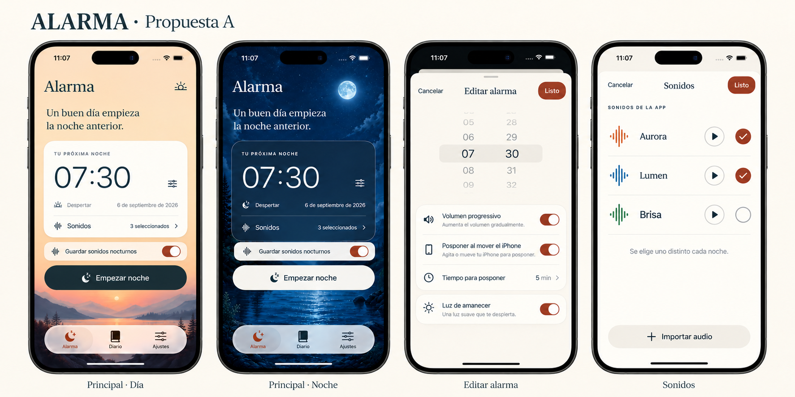
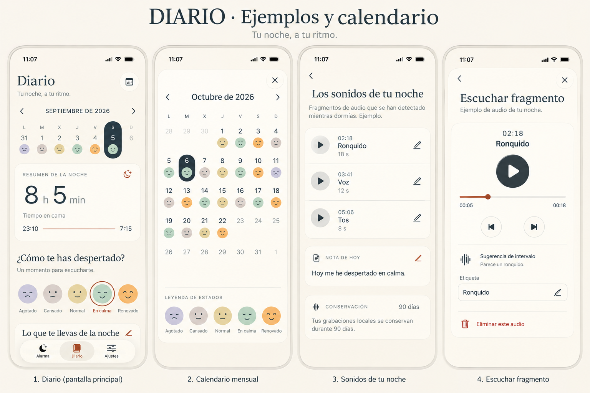
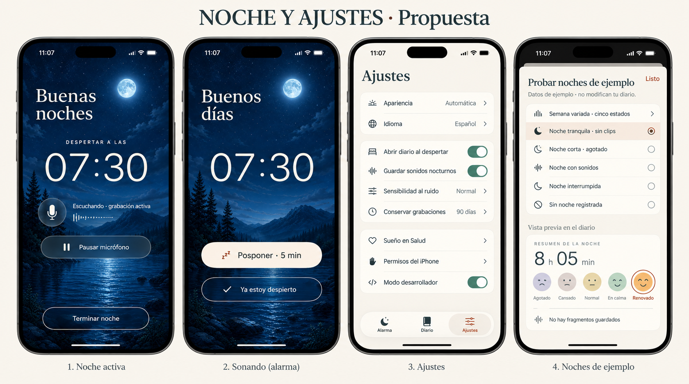
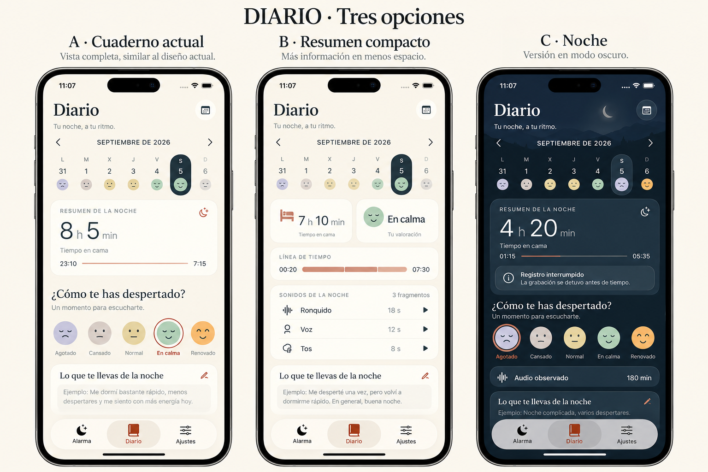

# UI de Alarma — propuestas 12/10/2026

Encargo: conservar la barra inferior Alarma / Diario / Ajustes y el aspecto
general, recuperar el fondo de noche aprobado y presentar todas las pantallas,
opciones de diario y noches de ejemplo. Las láminas son **maquetas generadas
con ChatGPT Imágenes**, no capturas de una build nativa. El usuario ha aprobado
la dirección A (cuaderno actual) con versión nocturna; las láminas conservan
su carácter ilustrativo.
Los textos y fechas dibujados por el generador son ilustrativos; la app usa
textos ES/EN y un calendario calculado a partir de las fechas reales.

## Láminas

- [Principal día/noche, editar alarma y sonidos](01-alarma.png).
- [Diario, calendario con caras, sonidos y detalle de un clip](02-diario-calendario.png).
- [Noche activa, alarma sonando, ajustes y ejemplos](03-noche-ajustes-ejemplos.png).
- [Opciones del diario](04-opciones-diario.png). A conserva el cuaderno actual,
  B propone un resumen compacto y C muestra la dirección nocturna. El usuario
  ha elegido **A · Cuaderno actual, con versión nocturna**. Se conserva su
  distribución y sus colores adaptativos claro/oscuro; B queda descartada.

Herramienta incorporada `image_gen`; prompts completos en `prompts.json`.
Fecha, idioma, pantalla y SHA de las imágenes registrados en `manifest.json`.
El primer borrador de principal se conserva como `01-alarma-borrador.png`:
el generador añadió sonidos y descripciones que no existen en la aplicación.
No se implementan esos añadidos ni se consideran parte del encargo.

## Cambios funcionales preparados

- Fondo nocturno original, copiado sin modificaciones del catálogo `native-ios`.
  SHA-256 `1343cbed98f6624d7afef12aa5bcab3be667cb82152ce3236bc5e5f82118c0c4`.
  Se usa en la principal oscura y en noche activa; se conserva el fondo de día.
- Semana y calendario mensual muestran la cara elegida para cada día:
  Agotado, Cansado, Normal, En calma y Renovado. Sin valoración: guion.
  Selección por día, accesibilidad, meses anteriores y bloqueo de días futuros.
- Ajustes → Ejemplos de diseño → Modo desarrollador. Al activarlo aparece
  «Probar noches de ejemplo» también en Diario. Seis escenarios: semana variada,
  tranquila, corta, sonidos, interrupción y sin registro. Se pueden recorrer
  tres semanas, cambiar la valoración, escribir notas y explorar clips de muestra.
- Las muestras usan un store separado en memoria: no leen ni escriben el
  archivo del diario, no programan alarmas, no piden micrófono/Salud y no borran
  ni reproducen archivos de audio reales. Los cambios se descartan al cerrar.
  Los clips son ejemplos visuales, identificados como tales y sin audio real.
- Retención predeterminada: **90 días** para configuraciones nuevas. Se conserva
  una elección previa guardada (incluidos 30 días o sin límite); se puede cambiar
  a 90 días en Ajustes → Conservar grabaciones.

Validación nativa enfocada **correcta**: cuatro pruebas de dominio/aislamiento
y un recorrido UI (5 pasadas, 0 fallos, 0 omitidas), compilación Release iPhone.
Fuente `2edfbcd52eaf6de315071e5903310a4a18838969`,
[ejecución Xcode](https://github.com/Krazel/Alarmy/actions/runs/38305125429).
Recibo en `validation.json` y resumen original en `native-test-summary.json`.
Capturas de simulador iPhone 17 Pro, iOS 26.4.1:

- [Noches de ejemplo y caras en semana](runtime/21-es-journal-examples.png).
- [Calendario mensual con caras](runtime/22-es-mood-calendar.png).
- [Diario real de la prueba: valoración y nota conservadas al cerrar muestras](runtime/23-es-journal-mood-week.png).
- [Modo desarrollador activado](runtime/24-es-developer-mode-enabled.png).

Estas capturas son nativas y contienen datos sintéticos de prueba. No equivalen
a una noche en dispositivo físico ni verifican la ejecución en iOS 16–25.
Tras presentar las propuestas, el usuario solicitó subir los cambios. Ya están
en **1.2 (1), TestFlight interno disponible** para el titular; API Apple confirma
VALID / IN_BETA_TESTING. [Entrega y recibos](../../../QA-2026-10-12-UI/README.md).
La noche física y la batería siguen pendientes.

Biblioteca PR-019 actualizada y releída por API, revisión 12; recibo
`library-receipt.json`, conservando versión, distribución e historial.
La entrega posterior 1.2 (1) quedó conciliada en revisión 13, con su recibo
separado en `QA-2026-10-12-UI/library-receipt.json` desde la raíz del producto.

